<div align="center">

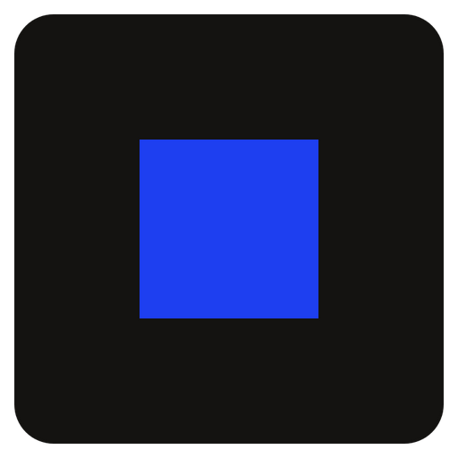

# DailyPot

**Give yourself a per-day allowance. Whatever you don't spend pays your bills.**

A free, offline personal-finance app for Windows. No account, no cloud, no ads.

[](https://github.com/450h/dailypot/actions/workflows/ci.yml)
[](https://github.com/450h/dailypot/releases/latest)
[](LICENSE)


### [⬇ Download the latest version](https://github.com/450h/dailypot/releases/latest)

<sub>Installer or portable exe · about 110 MB · free and open source · [install steps](#install)</sub>

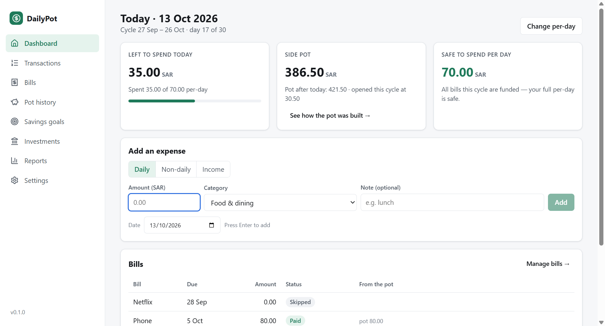

</div>

## What it does

1. **You set a per-day allowance.** Say 70 SAR a day.
2. **Whatever you don't spend goes into a side pot.** Spend 10 today and 60 goes in. Overspend tomorrow and the extra comes out.
3. **The pot pays your monthly bills**, nearest due date first: phone, gym, internet, subscriptions.

Your salary covers daily life *and* the bills. The app always shows you:

- what you can still spend **today**,
- what is in the **pot** and which bills it has already covered,
- a **safe-to-spend** figure that keeps every remaining bill funded this month,
- your **main balance** and **net worth**, recalculated from everything you have recorded.

Savings goals, an investment tracker and reports are built in. Everything stays on your PC.

## Install

1. Open the [latest release](https://github.com/450h/dailypot/releases/latest) and download one file:
   - `DailyPot-Setup-<version>.exe`, the installer (recommended), or
   - `DailyPot-<version>-portable.exe`, which runs from anywhere with no install.
2. Windows SmartScreen may say **"Windows protected your PC"**, because the app is not code-signed yet. Click **More info**, then **Run anyway**.
3. Enter your payday, your per-day allowance and your bills. That is the whole setup.

**Updating:** install the new version over the old one, or swap the portable exe. Your data stays where it is. The app upgrades its own data file on first launch and writes a backup before it does.

**Checking the download (optional):** every release ships `SHA256SUMS.txt`. Compare it with `certutil -hashfile DailyPot-Setup-<version>.exe SHA256`. Only download DailyPot from this repository's Releases page.

## How the pot works

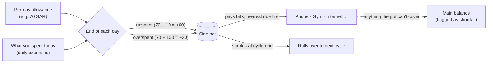

| Day | Spent | What happens | Pot |
|---|---|---|---|
| 1 | 10 | +60 into the pot | **60** |
| 2 | 70 | spent exactly the per-day | **60** |
| 3 | 100 | overspent by 30, which comes out of the pot | **30** |
| 4 | 20 | +50 | **80** |
| 5 | 40 | phone bill 80 paid from the pot (0 from main), then +30 | **30** |

One-off expenses (a car repair, a gift), income, savings and investments never touch the pot. The exact rules, with every edge case, are in [docs/05-data-model.md](docs/05-data-model.md).

## Everything in the app

| | |
|---|---|
| 📰 **A daily front page** | The dashboard opens like a broadsheet: your live main balance first, then the cycle's day strip, today's ring, the pot, bills, goals and investments. Figures count up and charts draw in each time you open it (off under Windows' reduced-motion setting). |
| 💰 **Live main balance and net worth** | Tell DailyPot your balance once. From then on it is recalculated from every income, expense, bill, saving and investment you record, never stored. Net worth = main balance + savings goals + portfolio value. |
| 🗓️ **Payday-to-payday cycles** | Budget months run from your salary day, not the 1st. Salary came early? Start the new cycle early. |
| 🫙 **Side pot** | Unspent per-day goes in, overspending comes out, and bills are paid **nearest due first**. Any surplus rolls over. |
| 🧮 **Safe-to-spend** | A daily figure that keeps every upcoming bill funded from the pot. It accounts for due dates and pot deficits, so it never errs in your favour. |
| 🔍 **Explainable** | The pot history shows every day's per-day, spending, bill payments and running balance. No black-box numbers. |
| ✅ **Never lose an unlogged day** | A day with nothing logged keeps asking, on the dashboard, in the day strip and in the pot history, until you add what you spent or confirm **Spent nothing**. |
| ⏪ **Extend tracking into the past** | Started late? Add earlier cycles before your first tracked day so old expenses, bills and income count, with a preview of what the pot will do. |
| 🧾 **Bills** | Recurring monthly bills with due days. Mark them paid or skip a month. A history shows how much came from the pot and how much from your main balance. |
| 💸 **Transactions** | Daily expenses, one-off expenses that don't touch the pot, and income, with categories, filters and CSV export. |
| 🎯 **Savings goals** | Targets with progress, plus "save X per month to reach it by …". |
| 📈 **Investments** | What you've put into each stock or fund, its current value (entered by you), and gain or loss. |
| 📊 **Reports** | Cycle summary with a comparison to the previous cycle, spending by category, daily spend vs per-day, pot and main balance over time, cycle over cycle and your portfolio. Every chart has a table view. |
| 🔒 **Private by design** | **No network access at all**: no account, cloud, telemetry or ads. Optional PIN lock and automatic daily backups. |
| 🌗 **Light and dark** | Follows Windows, or pick one yourself. Arabic notes display correctly. |

## Screenshots

<table>
  <tr>
    <td width="50%"><b>Unlogged days to confirm</b><br/>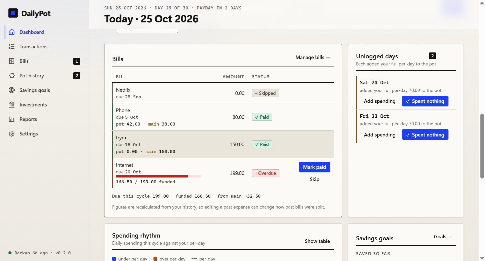</td>
    <td width="50%"><b>Pot history: every number explained</b><br/>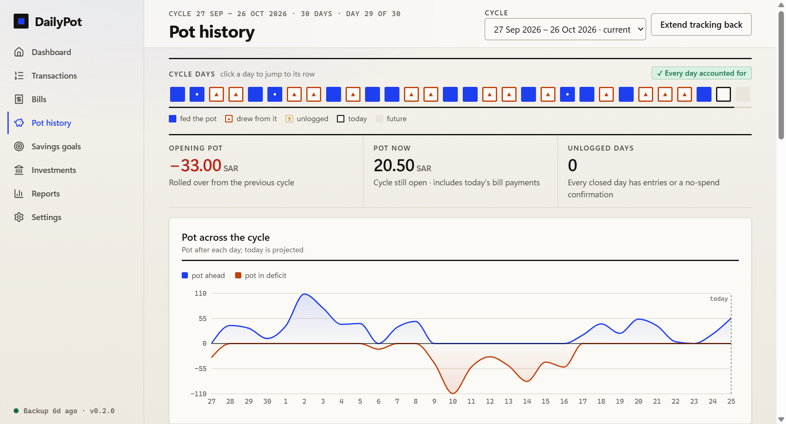</td>
  </tr>
  <tr>
    <td><b>Bills the pot pays</b><br/>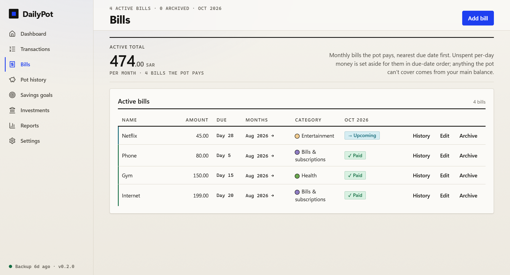</td>
    <td><b>Settings: balance anchor, cycles, backups</b><br/>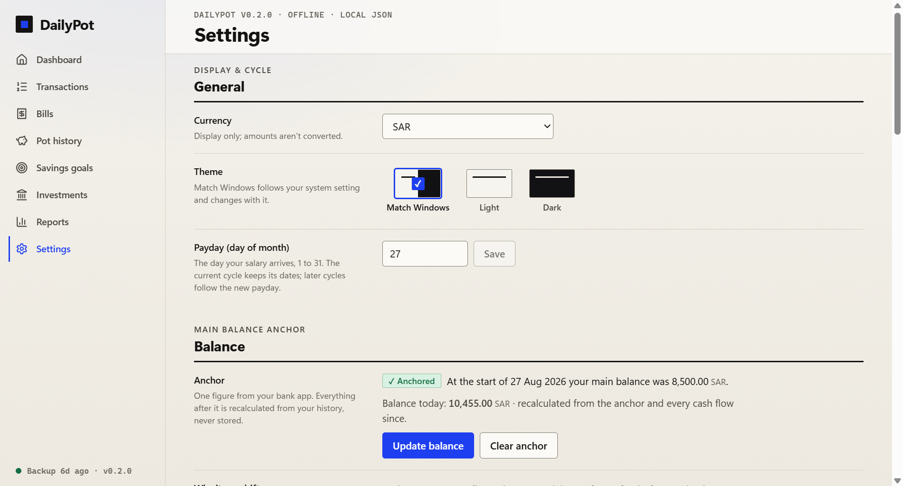</td>
  </tr>
  <tr>
    <td><b>Pay a bill: the pot pays first</b><br/>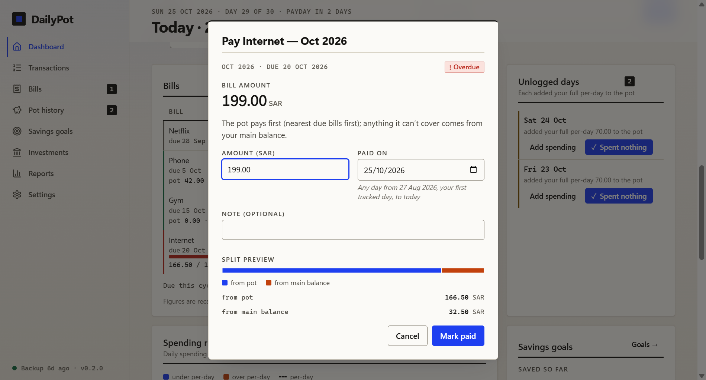</td>
    <td><b>Transactions</b><br/>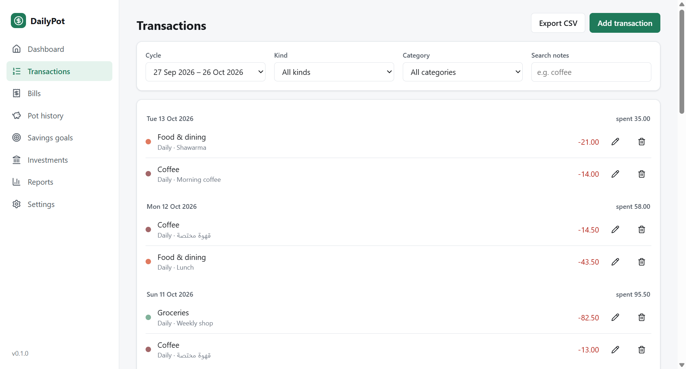</td>
  </tr>
  <tr>
    <td><b>Savings goals</b><br/>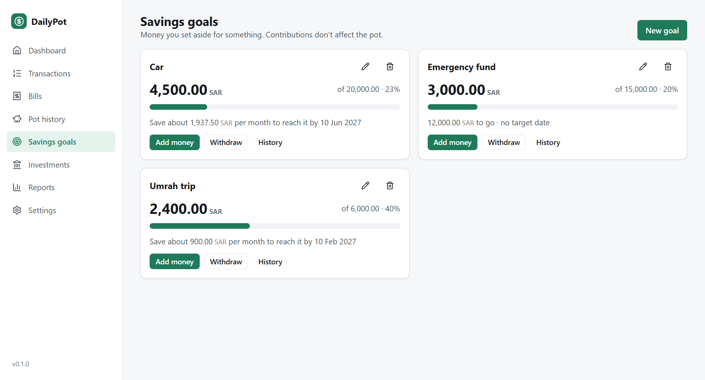</td>
    <td><b>Investments</b><br/>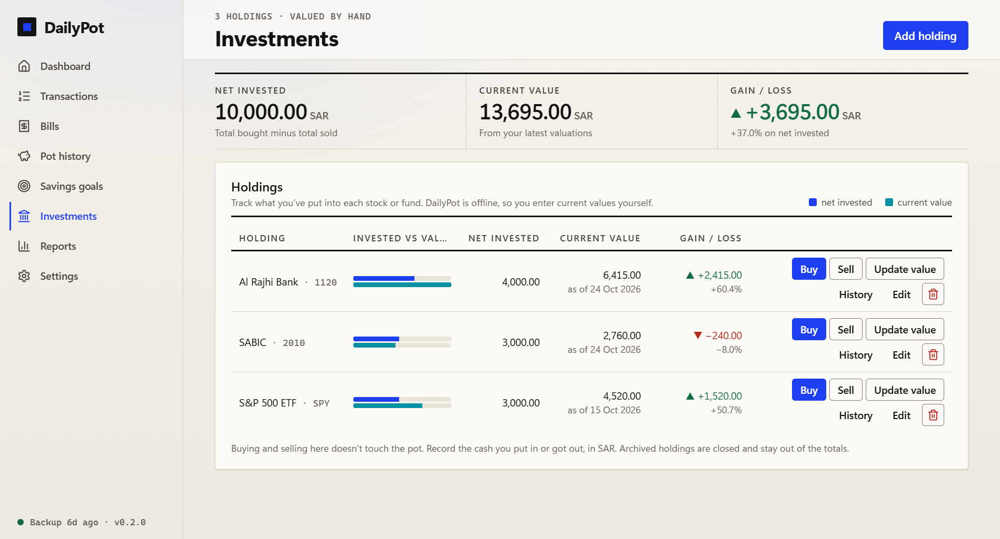</td>
  </tr>
  <tr>
    <td><b>Reports</b><br/>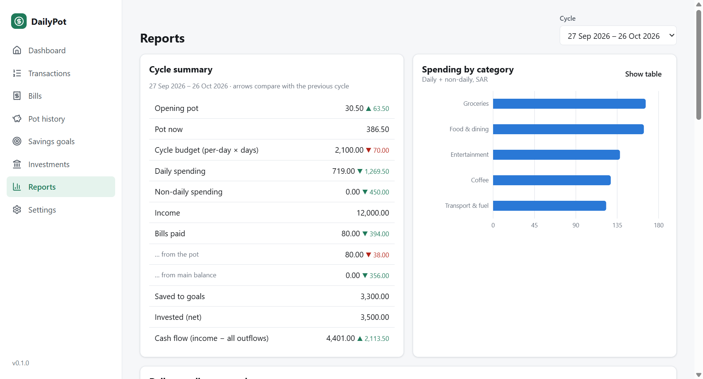</td>
    <td><b>Dark mode</b><br/>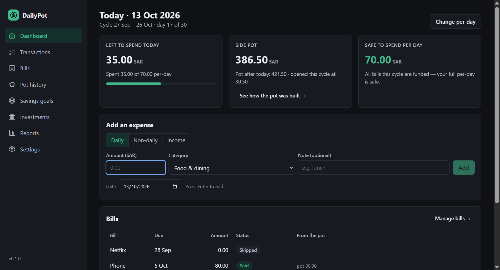</td>
  </tr>
  <tr>
    <td><b>Pot balance over time</b><br/>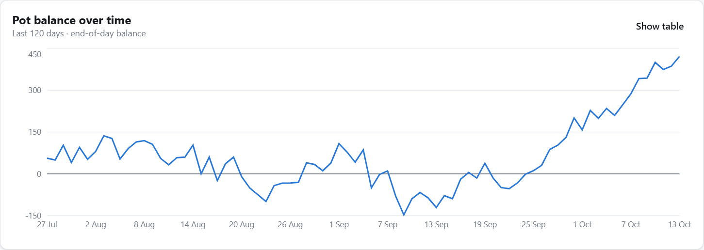</td>
    <td><b>Daily spending vs per-day</b><br/>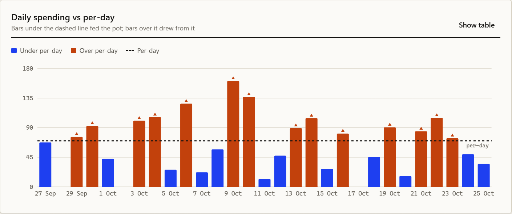</td>
  </tr>
  <tr>
    <td><b>Two-minute setup</b><br/>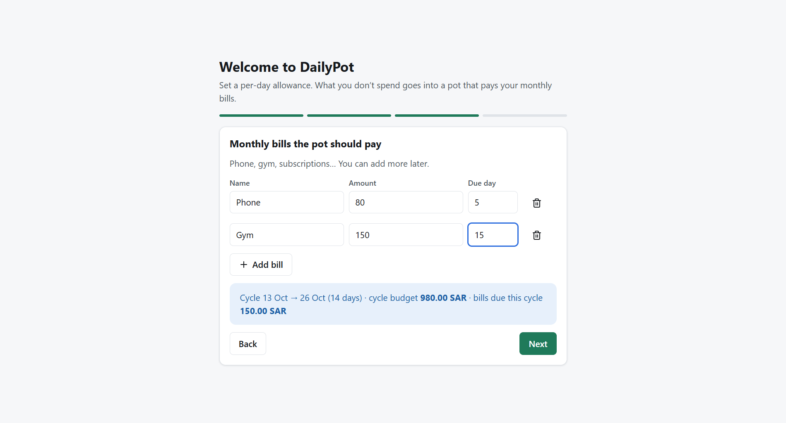</td>
    <td><b>Cycle over cycle</b><br/>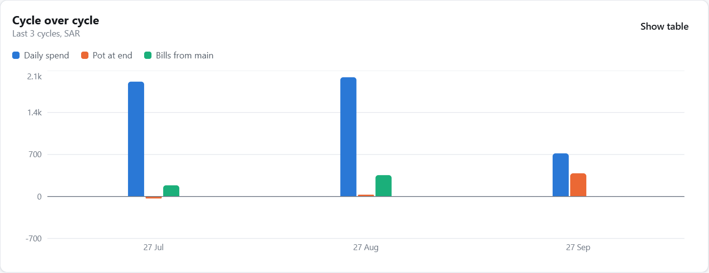</td>
  </tr>
</table>

<sub>Screenshots use generated demo data (<code>npm run screenshots</code>).</sub>

## Your data

- Everything is stored on your PC in `%APPDATA%\DailyPot`. **Nothing ever leaves your computer.**
- DailyPot keeps an automatic snapshot every day (the last 14). To keep a copy elsewhere, use **Settings → Backups & data → Export everything** and save it to OneDrive or a USB drive.
- Uninstalling keeps your data folder.
- **About the PIN:** it locks the app's screen but **does not encrypt** `data.json`. If you forget it, close DailyPot and delete `security.json` in the data folder. Your data stays.

## FAQ

<details><summary><b>What's the difference between "Daily" and "Non-daily" expenses?</b></summary>

*Daily* is everyday life (food, coffee, fuel) and counts against your per-day. *Non-daily* is a one-off, such as a car repair, a gift or a flight. It is paid from your main balance and doesn't touch the per-day or the pot, so one big purchase doesn't wipe out your bills money.
</details>

<details><summary><b>What happens if the pot can't cover a bill?</b></summary>

The pot pays what it can. The rest is marked as coming from your **main balance**, and the dashboard warns you ahead of time with the safe-to-spend figure.
</details>

<details><summary><b>Where does the main balance come from?</b></summary>

You type it once ("my balance right now is …", in the setup wizard, on the dashboard or under Settings → Balance). From then on DailyPot derives it: that anchor plus every income, minus every expense, paid bill, goal contribution and investment buy you record (sells and withdrawals come back). It is never stored, so editing a past entry corrects it. Money moved into a goal or a holding counts as money that **left** the main balance; it still counts in your net worth until you archive the goal or holding. If the figure drifts from your bank app (transfers, refunds, fees the app doesn't model), just set the balance again.
</details>

<details><summary><b>Why did the pot hold back money when I paid a bill?</b></summary>

The pot covers bills **nearest due date first**. If you pay a later bill early, money still needed for a bill due sooner stays reserved. The payment message tells you when this happens.
</details>

<details><summary><b>A bill was waived, or I paid it outside the app. What do I do?</b></summary>

Use **Skip** on that month. The bill no longer holds back pot money.
</details>

<details><summary><b>I forgot to log a day. What happens?</b></summary>

A day with nothing logged adds your full per-day to the pot. The dashboard lists every such day in the current cycle (and the week before it) with **Add spending** and **✓ Spent nothing**, the day strip marks it with a `?`, and the pot history has the same buttons on each row plus **Confirm all unlogged in this cycle**. The reminders stay until the day is logged or confirmed.
</details>

<details><summary><b>I started DailyPot late. Can I add earlier months?</b></summary>

Yes. **Pot history → Extend tracking back** (also under Settings → Budget cycles) adds cycles before your first tracked day, up to about three years back. You choose the per-day for those days, whether to mark them as "spent nothing", and whether past bill months count as paid before tracking. A preview shows the cycles it will create and what the pot will start at.
</details>

<details><summary><b>Does it get live stock prices or sync with my bank?</b></summary>

No. DailyPot never connects to the internet. That is deliberate ([ADR-0005](docs/decisions/0005-no-network-no-auto-update.md)). You enter investment values yourself.
</details>

<details><summary><b>How do I update to a new version?</b></summary>

Download the new installer from [Releases](https://github.com/450h/dailypot/releases/latest) and run it over the old version (or replace the portable exe). Your data folder is kept, and the app migrates its data file forward by itself with a backup first. There is no in-app update check, because the app never goes online.
</details>

<details><summary><b>Mac or Linux?</b></summary>

Windows only for now. The code is cross-platform Electron, so other platforms are possible later.
</details>

## Build from source

Requires **Node.js 22+** on Windows.

```bash
git clone https://github.com/450h/dailypot.git
cd dailypot
npm install
npm run dev          # run with hot reload (data in .dev-data/, never your real data)
npm test             # 127 unit tests: pot and balance engine, store, IPC rules
npm run test:e2e     # end-to-end tests against the built app
npm run dist         # build the installer + portable exe into dist/
npm run screenshots  # regenerate the README screenshots from demo data
```

Releases are built by GitHub Actions when a `v*` tag is pushed. Checksums and the release notes from `docs/releases/` are attached automatically.

## Under the hood

**Electron 44 · React 19 · TypeScript (strict) · zod · Recharts · Vitest · Playwright · electron-builder**

```
src/shared/engine/   the pot, cycles, bills, balance, reports: pure functions, fully unit-tested
src/main/            Electron main process: validation, JSON store, backups, PIN, IPC
src/preload/         the only bridge to the UI (named functions, nothing else)
src/renderer/        React UI
docs/                spec, money rules, design system, threat model, decisions (ADRs), open questions
```

Security: sandboxed renderer, strict CSP, all network requests blocked, validated IPC, hardened Electron fuses. See [docs/frameworks/SECURITY-FRAMEWORK.md](docs/frameworks/SECURITY-FRAMEWORK.md) and [docs/07-threat-model.md](docs/07-threat-model.md). Start reading the spec at [docs/README.md](docs/README.md).

## Contributing

Issues and pull requests are welcome. Please read [CONTRIBUTING.md](CONTRIBUTING.md) first. Report security issues privately ([SECURITY.md](SECURITY.md)).

## License

[MIT](LICENSE) © 2026 450h
