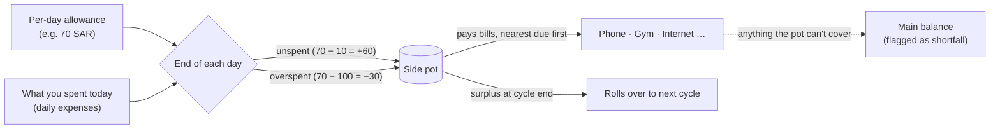

<div align="center">


# DailyPot

**A free, offline personal-finance app for Windows, built around one habit:**
**give yourself a per-day allowance. Whatever you don't spend pays your monthly bills.**

[](https://github.com/450h/dailypot/actions/workflows/ci.yml)
[](https://github.com/450h/dailypot/releases/latest)
[](LICENSE)


[**⬇ Download for Windows**](https://github.com/450h/dailypot/releases/latest) · [How it works](#how-the-pot-works) · [Screenshots](#tour) · [FAQ](#faq)


</div>

---

## The idea

Say your per-day is **70 SAR** and today you spend only **10**. The other **60** doesn't vanish into your bank balance. It goes into a **side pot**, and the pot pays your **phone bill (80)**, **gym**, **subscriptions**… If you overspend tomorrow, the extra comes out of the pot.

At any moment you know:
- **what you can still spend today**,
- **how much is in the pot**, and **which bills it has already covered**,
- **how much you can safely spend per day** and still have the pot cover every remaining bill this month.

Your salary covers daily life *and* the bills. Everything else is free for savings and investments.

## Features

| | |
|---|---|
| 🗓️ **Payday-to-payday cycles** | Budget months run from your salary day, not the 1st. Salary came early? Start the new cycle early. |
| 🫙 **Side pot** | Unspent per-day goes in, overspending comes out, and bills are paid **nearest-due first**. Any surplus rolls over. |
| 🧮 **Safe-to-spend** | A daily figure that keeps every upcoming bill funded from the pot. It accounts for due dates and pot deficits, so it never errs in your favour. |
| 🔍 **Explainable** | The pot history shows every day's per-day, spending, bill payments and running balance. No black-box numbers. |
| 🧾 **Bills** | Recurring monthly bills with due days. Mark them paid or skip a month. A history shows how much came from the pot and how much from your main balance. |
| 💸 **Transactions** | Daily expenses, **one-off (non-daily) expenses** that don't touch the pot, and income, with categories, filters and CSV export. |
| 🎯 **Savings goals** | Targets with progress, plus "save X per month to reach it by …". |
| 📈 **Investments** | What you've put into each stock or fund, its current value (entered by you), and gain or loss. |
| 📊 **Reports** | Cycle summary with comparison to the previous cycle, spending by category, daily spend vs per-day, pot over time, cycle over cycle and your portfolio. Every chart has a table view. |
| 🔒 **Private by design** | **No network access at all**: no account, cloud, telemetry or ads. Optional PIN lock and automatic daily backups. |
| 🌗 **Light & dark** | Follows Windows, or choose one yourself. Arabic notes display correctly. |

## How the pot works



| Day | Spent | What happens | Pot |
|---|---|---|---|
| 1 | 10 | +60 into the pot | **60** |
| 2 | 70 | spent exactly the per-day | **60** |
| 3 | 100 | overspent by 30, which comes out of the pot | **30** |
| 4 | 20 | +50 | **80** |
| 5 | 40 | phone bill 80 paid from the pot (0 from main), then +30 | **30** |

One-off expenses (car repair, gifts), income, savings and investments never touch the pot. The exact rules, with edge cases, are in [docs/05-data-model.md](docs/05-data-model.md).

## Tour

<table>
  <tr>
    <td width="50%"><b>Pot history: every number explained</b><br/></td>
    <td width="50%"><b>Bills the pot pays</b><br/></td>
  </tr>
  <tr>
    <td><b>Pay a bill: the pot pays first</b><br/></td>
    <td><b>Transactions</b><br/></td>
  </tr>
  <tr>
    <td><b>Savings goals</b><br/></td>
    <td><b>Investments</b><br/></td>
  </tr>
  <tr>
    <td><b>Reports</b><br/></td>
    <td><b>Dark mode</b><br/></td>
  </tr>
  <tr>
    <td><b>Pot balance over time</b><br/></td>
    <td><b>Daily spending vs per-day</b><br/></td>
  </tr>
  <tr>
    <td><b>Two-minute setup</b><br/></td>
    <td><b>Cycle over cycle</b><br/></td>
  </tr>
</table>

<sub>Screenshots use generated demo data (<code>npm run screenshots</code>).</sub>

## Download & install

1. Download from [**Releases**](https://github.com/450h/dailypot/releases/latest):
   - `DailyPot-Setup-x.y.z.exe`: the installer (recommended, ~110 MB)
   - `DailyPot-x.y.z-portable.exe`: no install, runs from anywhere
2. *Optional:* verify it against `SHA256SUMS.txt` in the release with `certutil -hashfile DailyPot-Setup-x.y.z.exe SHA256`.
3. The app isn't code-signed yet, so Windows SmartScreen may say **"Windows protected your PC"**. Click **More info → Run anyway**.

Only download DailyPot from this repository's Releases page.

## Your data

- Everything is stored on your PC in `%APPDATA%\DailyPot`. **Nothing ever leaves your computer.**
- DailyPot keeps an automatic snapshot every day (the last 14). To keep a copy elsewhere, use **Settings → Backups & data → Export everything** and save it to OneDrive or a USB drive.
- Uninstalling keeps your data folder.
- **About the PIN:** it locks the app's screen but **doesn't encrypt** `data.json`. If you forget it, close DailyPot and delete `security.json` in the data folder. Your data stays.

## FAQ

<details><summary><b>What's the difference between "Daily" and "Non-daily" expenses?</b></summary>

*Daily* is everyday life (food, coffee, fuel) and counts against your per-day. *Non-daily* is a one-off, such as a car repair, a gift or a flight. It's paid from your main balance and doesn't touch the per-day or the pot, so one big purchase doesn't wipe out your bills money.
</details>

<details><summary><b>What happens if the pot can't cover a bill?</b></summary>

The pot pays what it can. The rest is marked as coming from your **main balance**, and the dashboard warns you ahead of time with the safe-to-spend figure.
</details>

<details><summary><b>Why did the pot hold back money when I paid a bill?</b></summary>

The pot covers bills **nearest due date first**. If you pay a later bill early, money still needed for a bill due sooner stays reserved. The payment message tells you when this happens.
</details>

<details><summary><b>A bill was waived, or I paid it outside the app. What do I do?</b></summary>

Use **Skip** on that month. The bill no longer holds back pot money.
</details>

<details><summary><b>I forgot to log a day. What happens?</b></summary>

A day with nothing logged adds your full per-day to the pot. The dashboard asks about yesterday: add what you spent, or tap **✓ I spent nothing**. The pot history marks unlogged days.
</details>

<details><summary><b>Does it get live stock prices or sync with my bank?</b></summary>

No. DailyPot never connects to the internet. That's deliberate ([ADR-0005](docs/decisions/0005-no-network-no-auto-update.md)). You enter investment values yourself.
</details>

<details><summary><b>Mac or Linux?</b></summary>

Windows only for now. The code is cross-platform Electron, so other platforms are possible later.
</details>

## Build from source

Requires **Node.js 22+** on Windows.

```bash
git clone https://github.com/450h/dailypot.git
cd dailypot
npm install
npm run dev          # run with hot reload (data in .dev-data/, never your real data)
npm test             # 85 unit tests: pot engine, store, IPC rules
npm run test:e2e     # end-to-end tests against the built app
npm run dist         # build the installer + portable exe into dist/
npm run screenshots  # regenerate the README screenshots from demo data
```

Releases are built by GitHub Actions when a `v*` tag is pushed. Checksums are attached automatically.

## Tech & project layout

**Electron 44 · React 19 · TypeScript (strict) · zod · Recharts · Vitest · Playwright · electron-builder**

```
src/shared/engine/   the pot, cycles, bills, reports: pure functions, fully unit-tested
src/main/            Electron main process: validation, JSON store, backups, PIN, IPC
src/preload/         the only bridge to the UI (named functions, nothing else)
src/renderer/        React UI
docs/                spec, money rules, threat model, decisions (ADRs), open questions
```

Security: sandboxed renderer, strict CSP, all network requests blocked, validated IPC, hardened Electron fuses. See [docs/frameworks/SECURITY-FRAMEWORK.md](docs/frameworks/SECURITY-FRAMEWORK.md) and [docs/07-threat-model.md](docs/07-threat-model.md).

## Contributing

Issues and pull requests are welcome. Please read [CONTRIBUTING.md](CONTRIBUTING.md) first. Report security issues privately ([SECURITY.md](SECURITY.md)).

## License

[MIT](LICENSE) © 2026 450h
