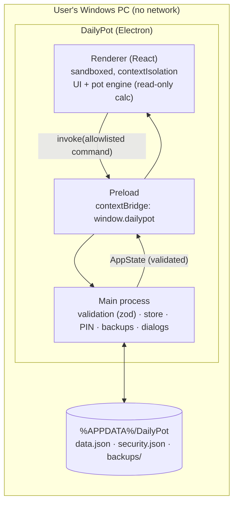

# 04 — Architecture

## System diagram

- **Main process** (`src/main/`) owns the file system, validation, PIN checks, backups and native dialogs. It is the only writer.
- **Preload** (`src/preload/`) exposes a small typed API (`window.dailypot`) via `contextBridge`. It exposes no Node or Electron objects.
- **Renderer** (`src/renderer/`) is a React SPA. It holds the latest `AppState` from main and computes all figures with the **pure shared engine**.
- **Shared** (`src/shared/`) holds the zod schemas (one source of truth for types), money and date helpers, and the engine (`cycles`, `obligations`, `pot`, `reports`). Both processes import it, and it is unit-tested once.

## Data flow for a write
Renderer calls `dailypot.upsert('transactions', tx)` → main checks sender, lock state and the zod schema → main checks references → main applies the change to its in-memory state → main does an atomic write (`data.json.tmp` → fsync → rename) → main returns the new `AppState` → renderer re-renders.

## Hosting & data location (the residency analogue)
There's no server and no cloud. All data stays in the user's Windows profile (`%APPDATA%/DailyPot`). The app makes **no network requests**: production builds block all `http(s)`/`ws(s)` requests at the session level, and there is no auto-update and no telemetry. Durability comes from atomic writes, 14 daily snapshots, and user-driven export to any folder (USB, OneDrive, etc.). See [ADR-0002](decisions/0002-local-json-storage-and-backups.md) and [ADR-0005](decisions/0005-no-network-no-auto-update.md).

## Distribution
GitHub Releases host an **NSIS installer** (`DailyPot-Setup-x.y.z.exe`) and a **portable** `.exe`, both built by GitHub Actions on a version tag, with SHA-256 checksums published. v1 is **unsigned**, so Windows SmartScreen will warn ("Windows protected your PC" → *More info* → *Run anyway*). Without signing, Windows reportedly blocks unrecognized apps behind that prompt. A standard (OV) certificate shows the publisher name but needs time to build reputation, while an EV certificate is trusted sooner ([electron-builder code signing docs](https://www.electron.build/docs/features/code-signing/), [Electron code signing tutorial](https://electronjs.org/docs/tutorial/code-signing), accessed 2026-10-13, confidence **Medium**, secondary sources). Signing is an open decision (OPEN-QUESTIONS D2).

## Third parties
No external vendor holds any data or money, so there is no `THIRD-PARTY-REGISTER.md`. The only third parties are open-source npm dependencies (supply chain, see [SECURITY-FRAMEWORK §2](frameworks/SECURITY-FRAMEWORK.md)) and GitHub (hosts the code and release binaries).

## One-way doors
| Door | Why it's hard to reverse | Reversal cost | ADR |
|---|---|---|---|
| Electron + React stack | Rewriting the UI layer | Weeks | [0001](decisions/0001-stack-electron-react.md) |
| On-disk data format (`data.json`, schemaVersion 2) | Real user data exists in this shape | Low, because schemaVersion + migrations make it a two-way door if kept up | [0002](decisions/0002-local-json-storage-and-backups.md) |
| Integer minor units for money | Every stored amount | High if changed later | [0003](decisions/0003-money-as-integer-minor-units.md) |
| MIT license | Published code stays MIT forever | Can't be un-licensed | [0006](decisions/0006-license-mit.md) |
