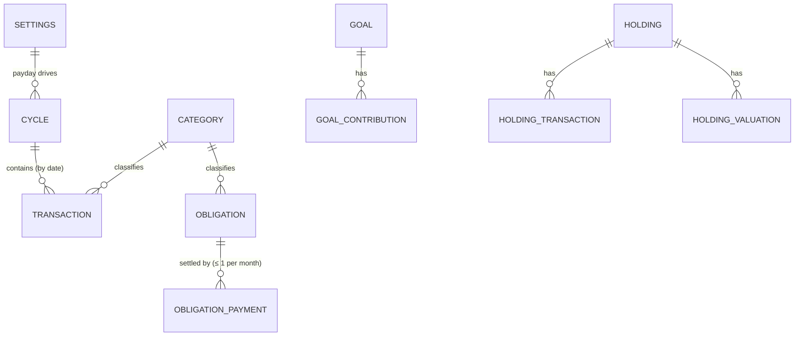
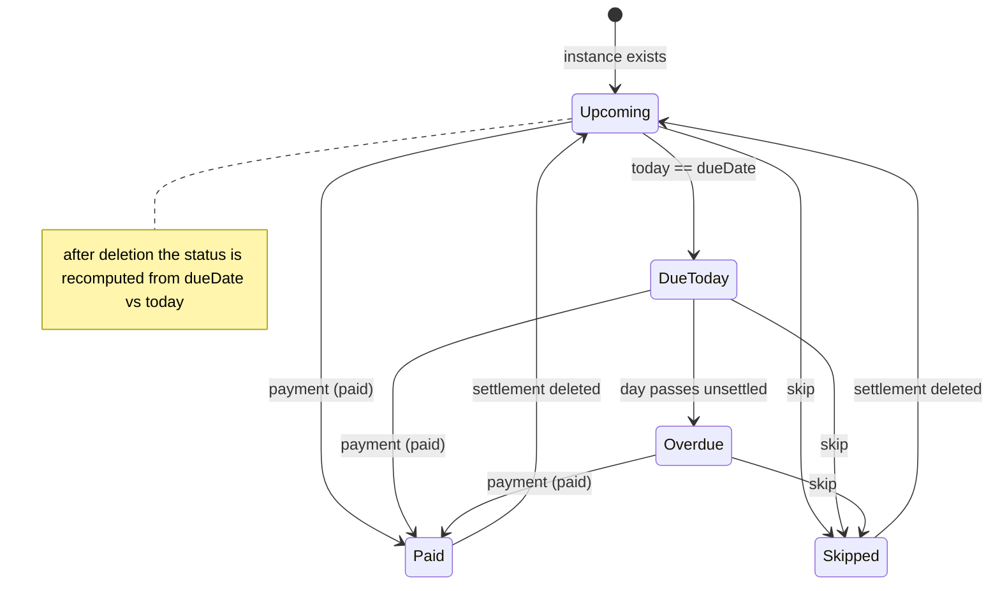

# 05 — Data model & the pot engine

This chapter is the **source of truth for the money rules**. If code and this chapter disagree, one of them is a bug: fix it or write an ADR. Every numbered rule here has at least one unit test.

## 1. Conventions
- **Money** is stored as **integer minor units**, e.g. halalas for SAR (`70.00 SAR` → `7000`). Never floats. Formatting is display-only ([ADR-0003](decisions/0003-money-as-integer-minor-units.md)). Supported currencies have exactly 2 decimals: `SAR, AED, QAR, USD, EUR, GBP, EGP, INR, PKR, TRY, CAD, AUD`. Three-decimal currencies (KWD, BHD, OMR, JOD) are excluded in v1.
- **Dates** are local calendar dates stored as `YYYY-MM-DD` strings. The money logic uses no times or time zones. "Today" is the PC's local date. `createdAt` is an ISO timestamp, used only for tie-breaking and display.
- **IDs** are UUID v4, **generated by the renderer**. Main validates their format. An upsert with an unknown id creates the item and one with an existing id updates it, so retries are idempotent. Main sets `createdAt` on create and keeps it on update.
- The **pot is derived, never stored**. It's recomputed from history every time ([ADR-0004](decisions/0004-derived-pot-ledger.md)), so editing past data changes later pot figures, including past bill splits. The UI says: "figures are recalculated from your history".

## 2. Entities



AppState keys (these are also the IPC collection names): `settings`, `categories`, `cycles`, `transactions`, `obligations`, `obligationPayments`, `goals`, `goalContributions`, `holdings`, `holdingTransactions`, `holdingValuations`, `confirmedDays`, plus `schemaVersion`.

| Collection | Fields (required unless `?`) | Notes |
|---|---|---|
| `settings` | `currency` (from the §1 list, default `SAR`), `payday` (1–31), `theme` (`system`/`light`/`dark`), `autoLockMinutes` (0–240; 0 = off), `setupComplete` (bool), `lastExportAt?` (ISO, set by main) | Single record, changed only via `settings:update` / `setup:complete`. |
| `categories` | `id`, `name` (1–40 chars), `kind` (`expense`/`income`), `color` (`#rrggbb`), `archived` | Seeded defaults. A category that's in use can only be archived. |
| `cycles` | `id`, `startDate`, `endDate`, `dailyAllowance` (minor ≥ 0) | Contiguous and non-overlapping. Changed only through `cycle:*` commands (§3). |
| `transactions` | `id`, `date`, `amount` (minor > 0), `kind` (`daily`/`nonDaily`/`income`), `categoryId`, `note?` (≤ 200), `createdAt` | `daily`/`nonDaily` need an **expense** category and `income` needs an **income** category. Only `daily` affects the pot. |
| `obligations` | `id`, `name` (1–40), `amount` (minor > 0), `dueDay` (1–31), `categoryId?` (expense), `startMonth` (`YYYY-MM`), `endMonth?` (`YYYY-MM`, ≥ startMonth), `note?` | A recurring monthly bill. |
| `obligationPayments` | `id`, `obligationId`, `period` (`YYYY-MM`), `status` (`paid`/`skipped`), `date`, `amount` (minor; > 0 if paid, = 0 if skipped), `note?`, `createdAt` | **One per (obligation, period)**, the instance's settlement. "Skipped" means waived, cancelled or paid outside DailyPot. For a skip, `date` is the day it was recorded (≤ today; it may be before the instance's dueDate). |
| `goals` | `id`, `name`, `targetAmount` (minor > 0), `targetDate?`, `archived`, `createdAt` | |
| `goalContributions` | `id`, `goalId`, `date`, `amount` (minor, **signed**, ≠ 0; negative = withdrawal), `note?` | |
| `holdings` | `id`, `name`, `symbol?`, `note?`, `archived` | |
| `holdingTransactions` | `id`, `holdingId`, `date`, `kind` (`buy`/`sell`), `amount` (minor > 0 cash), `quantity?` (> 0), `note?` | |
| `holdingValuations` | `id`, `holdingId`, `date`, `value` (minor ≥ 0) | Manual value snapshots. |
| `confirmedDays` | `id`, `date` (unique) | "I spent nothing on this day". It silences the unlogged-day nudge and has no money effect. Upserting a date that already exists keeps the existing record (idempotent). |

The **PIN** is not part of AppState. It lives in `security.json`, owned by main, and is never sent to the renderer or exported.

### File layout (`%APPDATA%/DailyPot/`)
```
data.json                      ← AppState (+ schemaVersion)
security.json                  ← { pinHash, pinSalt, scrypt params } or absent
backups/data-YYYY-MM-DD.json   ← daily snapshots, newest 14 kept
backups/pre-import-<ts>.json · pre-restore-<ts>.json · pre-migration-<ts>.json   (<ts> = YYYYMMDDTHHmmss, kept until deleted)
data.corrupt-<ts>.json         ← a file that failed to load, kept for recovery
logs/main.log                  ← errors only, ≤ 1 MB, rotated
```

### Authorization model
There's a single local user, so there are no roles. The **access boundary is the IPC bridge**:
- The renderer can only call the named preload functions.
- Main checks the sender origin and the lock state, then validates the payload with **strict** zod schemas (unknown keys are rejected) and checks references before persisting.
- `entity:upsert`/`entity:delete` accept only these collections: `categories`, `transactions`, `obligations`, `obligationPayments`, `goals`, `goalContributions`, `holdings`, `holdingTransactions`, `holdingValuations`, `confirmedDays`.
- While a PIN is set and the app is locked, every command except `pin:status`/`pin:verify` is refused.

### Write-time validation (IPC only, never when loading a file; see §9)
- Dates of transactions, payments, contributions, holding transactions, valuations and confirmed days must be **≤ today**.
- Payments: the obligation must exist; `period` must be within `startMonth..endMonth`; the instance's dueDate must be ≥ `firstCycle.startDate`; `date` must be ≥ `firstCycle.startDate`.
- The category kind must match the transaction kind (see the table above).

### Referential rules (main)
- **Category** in use → can't be deleted (archive it). At least one active expense category and one active income category must remain.
- **Obligation** with payments → can't be deleted. Archive it by setting `endMonth = max(current month, latest settled period)`. Editing `startMonth`/`endMonth` can't leave an existing payment outside the range. Editing `dueDay`/`amount` is allowed and changes only unsettled instances (and the pot recomputes).
- **Goal / holding** delete → cascades to its children (after confirmation in the renderer).
- **Cycles**: no generic upsert or delete. See §3.

## 3. Budget cycles (payday to payday)
- `paydayIn(y, m) = min(settings.payday, daysInMonth(y, m))`.
- `nextPaydayAfter(d)` = the first payday occurrence **strictly after** `d`.
- A normal cycle starting on `S` ends on `nextPaydayAfter(S) − 1`.
- **First cycle:** setup supplies `firstCycleStart`. It must be **≤ today** and ≥ today − 62 days. If it's in the past, the wizard warns: "N days with no entries will each add your full per-day to the pot. Backfill them, or start today."
- **`ensureCycles(today)`** runs at startup and at the local midnight rollover. While `today > last.endDate`, it appends `{start: last.endDate + 1, end: nextPaydayAfter(start) − 1, dailyAllowance: last.dailyAllowance}`. When at least one cycle is appended, the dashboard shows "New cycle started — confirm your per-day". There's no separate default allowance: a new cycle copies the last one.
- **Changing the per-day (`cycle:setAllowance`)** works on the **current cycle only** and applies to **all of its days, including past ones**. Before confirming, the UI previews the effect: "pot changes by −380 SAR (20 days × −19)". Closed cycles can't be edited.
- **Changing the payday** affects only cycles created afterwards. The current cycle keeps its end date. The settings screen previews the next two cycles' dates.
- **Start the new cycle early** (`cycle:startNextEarly {startDate}`), for when the salary arrives before the scheduled payday `P = current.endDate + 1`:
  - Allowed when `today ≥ P − 7`. `startDate` must be in `[max(current.startDate + 1, P − 7), today]` (default today).
  - Effect: `current.endDate = startDate − 1`. The new cycle runs from `startDate` to `nextPaydayAfter(P) − 1`, so it absorbs the replaced payday instead of creating a tiny cycle. Its allowance copies the current one.
  - Example: payday 27, current cycle 27 Sep–26 Oct, early start 24 Oct → cycles 27 Sep–23 Oct and **24 Oct–26 Nov**.
- Days **before the first cycle** are outside the system. Expenses dated then still show in lists and reports but don't affect the pot.

## 4. Obligation instances
- An obligation has **one instance per calendar month** `YYYY-MM` from `startMonth` to `endMonth` (or open-ended), with `dueDate = YYYY-MM-min(dueDay, daysInMonth)`. The key is `obligationId:YYYY-MM`.
- Instances with `dueDate < firstCycle.startDate` don't exist, as far as the app is concerned.
- **Default `startMonth`** when creating an obligation is the first month whose dueDate is ≥ today. In the setup wizard it's ≥ `firstCycleStart`. It's editable in the form, so a bill already paid this month isn't treated as overdue.
- An instance belongs to the cycle containing its dueDate. Cycles don't line up with months, so a cycle occasionally holds **0 or 2** instances of the same bill. Each calendar month is billed exactly once. The UI notes it when a cycle has 2 instances.
- Instance status: **Paid** (settlement `paid`), **Skipped** (settlement `skipped`), **Overdue** (unsettled and dueDate < today), **Due today**, **Upcoming**.
- **Effective amount** of an instance: the payment amount if paid, 0 if skipped, otherwise the obligation's current `amount`.
- **Prepaying** an instance due after the current cycle's end is allowed and draws from the pot under rule 4.

## 5. The pot — rules (decided by the owner at intake unless marked)
**Instance order** (used everywhere): `dueDate`, then obligation `name`, then `id`.

1. **Day delta.** For every *closed* day `d` (`firstCycle.startDate ≤ d < today`): `delta(d) = cycleOf(d).dailyAllowance − Σ daily transactions dated d`.
2. **Underspend feeds the pot and overspend drains it.** The balance changes by `delta(d)`, positive or negative. The pot **can go negative** (shown as a "pot deficit").
3. **Today is open.** Today's delta is shown as *projected* and added only once the day closes.
4. **Bills draw from the pot, nearest due date first.** When instance X is paid on date `p`:
   - `reserved = Σ effective amounts of instances I` where I comes before X in instance order, `I.dueDate ≥ firstCycle.startDate`, and I is **not yet paid at that moment** (no `paid` settlement dated before X's payment in processing order, rule 5). Skipped instances are never reserved. This uses the *eventual* payment amount if I is paid later, so editing that amount re-splits earlier payments. This is intended. It doesn't depend on today or on cycle boundaries.
   - `fromPot = clamp(balance − reserved, 0, amount)`, `fromMain = amount − fromPot`, `balance −= fromPot`.
   - `fromMain > 0` is a **shortfall**: part of the bill came from the main balance and is flagged. After a payment where the pot held money but reservations took it, the toast explains: "100 in pot is set aside for Gym (due 3rd)".
5. **Processing order on date `d`:** first the `paid` settlements dated `d`, in instance order; then day `d` closes, if `d < today`. A payment uses the pot as it was at the start of its day. **The current balance shown includes payments dated today.**
6. **Surplus rolls over.** The pot is one continuous timeline. A cycle's **closing pot** is the next cycle's **opening pot**, positive or negative (owner-confirmed: surplus rolls over; carrying a deficit follows from "overspend comes from the pot", see D5). Whether leftover pot should repay same-cycle shortfalls is open (D9). The current rule doesn't do that.
7. **Non-daily expenses, income, goal contributions, holding transactions and skipped bills never touch the pot.**
8. Items dated after today are ignored by the engine. IPC rejects them, but a file from a PC whose clock was later set backwards may contain them (§9).

### Worked example (from the intake)
Per-day 70 SAR. Phone 80 SAR due on the 5th. The cycle starts on the 1st.

| Day | Spent | Payment (start of day) | Delta | Pot after day |
|---|---|---|---|---|
| 1 | 10 | – | +60 | 60 |
| 2 | 70 | – | 0 | 60 |
| 3 | 100 | – | −30 (overspend from pot) | 30 |
| 4 | 20 | – | +50 | 80 |
| 5 | 40 | phone 80 → fromPot 80, fromMain 0 (pot 0) | +30 | 30 |

### Earmarks ("funded" view, display only)
Take the **open instances**: unsettled, with dueDate ≥ `firstCycle.startDate` and ≤ `current.endDate`. Walk them in instance order and allocate `max(balance, 0)`: `funded = min(remaining, effective amount)`. For example: "Phone 80/80 ✓ · Gym 30/150".

### Safe-to-spend (dashboard guidance; never optimistic)
Use the open instances in instance order, the signed current `balance` (rule 5), the current cycle's allowance `A` and today `t`. For each instance k, let `C_k` = the running total of effective amounts up to and including k.
- `n_k = dueDate_k − t` in days, which is the number of days that close before k is paid (today included).
- If `n_k ≤ 0` (due today or overdue), spending less can't help: `fromMainNow = max(fromMainNow, C_k − balance, 0)`, reported as "about X of today's/overdue bills will come from your main balance".
- If `n_k > 0`: `need_k = ceil(max(0, C_k − balance) / n_k)`.
- `safeDaily = A − max(need_k over n_k > 0)` (with no such k, `safeDaily = A`).

Display: if `safeDaily ≥ A`, show "all bills are funded, your full per-day is safe". If `0 ≤ safeDaily < A`, show "spend ≤ safeDaily per day to cover your bills from the pot". If `safeDaily < 0`, show "the pot can't cover the upcoming bills even if you spend nothing; about `max_k(C_k − balance − A × n_k)` will come from your main balance".
Today's spending counts toward `safeDaily`, so the "remaining today" line uses `safeDaily − spentToday` alongside `A − spentToday`.

**Unlogged days:** a closed day in a cycle with no daily transactions and no `confirmedDays` entry is *unlogged*. The dashboard nudges about yesterday ("No spending logged yesterday: add it, or confirm you spent nothing") and the pot history marks unlogged days.

## 6. Reports
- **Attribution:** payments, `fromPot`/`fromMain` and shortfalls are counted by **payment date**. Instances (planned bills) are counted by **dueDate**.
- **"Bills" on the dashboard** = this cycle's instances (all statuses) + earlier unsettled (overdue) instances + any prepaid future instances paid during this cycle.
- **Per cycle `[S, E]`:**
  - opening pot, and closing pot (or the current pot if the cycle is open);
  - total allowance (`A × days on or after firstCycle.start`);
  - daily spend, non-daily spend and income;
  - bills paid, split into total, fromPot and fromMain, with a shortfall count;
  - goal net contributions and investment net (buys − sells);
  - **cash flow** = income − (daily + non-daily + bills paid + goal net + investment net).
- The pot is an earmark inside cash that's already counted, so it isn't subtracted separately.

## 7. Investments & goals
- **Net invested** = Σ buys − Σ sells.
- **Current value:**
  - With no valuation: net invested, labelled "no valuation yet".
  - Otherwise: latest valuation `V` on date `v`, plus buys − sells dated **after** `v`. If such flows exist, the value is labelled "estimated — update value".
- **Gain** = value − net invested. **Gain %** is shown only when net invested > 0.
- **Fully sold** (value 0 with no later buys) shows "closed" with realised gain = −net invested.
- **Portfolio** totals cover non-archived holdings.
- **Goal saved** = Σ contributions. The progress bar is capped at 100%.
- **Months left** to `targetDate` = `(ty − y) × 12 + (tm − m) + (td > d ? 1 : 0)`, with a minimum of 1. **Needed per month** = `ceil(max(0, target − saved) / monthsLeft)`. A past target date shows "target date passed".

## 8. State machines

```mermaid
stateDiagram-v2
  [*] --> Locked : start with PIN set
  [*] --> Unlocked : start without PIN
  Locked --> Unlocked : correct PIN
  Locked --> Locked : wrong PIN (backoff grows; resets on app restart)
  Unlocked --> Locked : Lock now / idle ≥ autoLockMinutes / Windows lock-screen
```





## 9. Loading, schema versions and clock safety
- `data.json` carries `schemaVersion` (starting at `1`). On load, main parses the file and runs forward-only migrations `vN → vN+1` in memory, then validates with the **load schema**. The load schema is the same as the write schema **minus the "≤ today" checks**, so a backwards clock can never flag a good file as corrupt. If a migration ran, main writes a `pre-migration-<ts>` backup and then saves.
- A file with a **newer** `schemaVersion` opens **read-only** (writes are refused, with a banner telling the user to update the app) and is never overwritten. **Downgrade note:** after an upgrade has migrated your data, an older version opens it read-only. To go back, restore the `pre-migration` backup.
- **Parse or validation failure:** the file is renamed to `data.corrupt-<ts>.json`, then the snapshots are tried newest-first and the first valid one is loaded, with a banner. If **no** snapshot is valid, the app does **not** start the setup wizard silently. It shows a recovery screen with the paths and two choices: "Import a backup file…" or "Start fresh (your corrupt file stays at …)".
